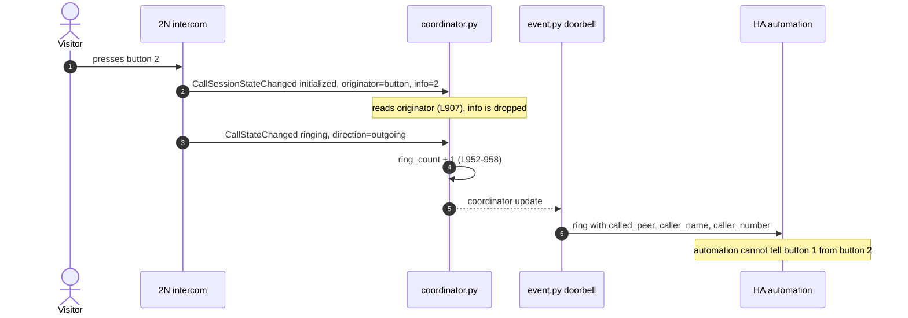
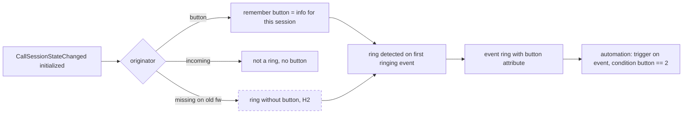

# Analysis: DRAFT-1 per-button doorbell

Status: analysis prototype (2026-10-24). Draft: DRAFT-1. Source issue: #10.

## Summary

The intercom already tells us which call button was pressed. `CallSessionStateChanged` carries `originator=button` and `info="<button number>"`, and it carries them in the very first session event (`initialized`), before the ring is detected. The integration reads `originator` but never reads `info`, so the button number is dropped in `coordinator.py`. Since TASK-55 the doorbell event entity is the only doorbell entity, so the smallest useful change is a `button` attribute on the existing `ring` event.

## Facts (seen in code, docs or captured events)

| # | Fact | Where |
|---|---|---|
| F1 | A button press sends `CallSessionStateChanged` with `originator=button` and `info=<button number>`; a call into the intercom has `originator=incoming` and no `info` | `docs/API_REFERENCE.md:334-344` |
| F2 | Event order on a button press: session `initialized` (with `session`, `originator`, `info`) → call `connecting` → session `connecting` → call `ringing` → session `ringing` → `terminated` | captured sequence in `tests/test_coordinator.py:666-692` (TASK-29 capture) |
| F3 | The coordinator reads `originator` and uses it to tell a button ring from an incoming call; `info` is never read | `coordinator.py:907`, `coordinator.py:944-951` |
| F4 | A ring is counted once per call, on the first ringing event (call or session) | `coordinator.py:952-958` |
| F5 | The doorbell event entity has one event type `ring` with attributes `called_peer`, `caller_name`, `caller_number` | `event.py:35`, `event.py:56-66` |
| F6 | The doorbell `binary_sensor` was removed; the event entity is the only doorbell entity | TASK-55 (Done) |
| F7 | The `called_id` filter is one peer per config entry | `coordinator.py:247`, `coordinator.py:940-943` |

## Hypotheses (not verified)

| # | Hypothesis | How to verify |
|---|---|---|
| H1 | Every button press, on every button, sends `info` in session `initialized` (only button 1 was captured) | press button 2 on a multi-button intercom, read the event log |
| H2 | fw 2.50 does not send `originator`/`info`; the ring still works via `CallStateChanged direction=outgoing`, only the button number is missing | event log on a fw 2.x device |
| H3 | Calls from keypad, display directory or API use other `originator` values without a button number | event log while calling from keypad/display |

## Today: where the button number is lost

## Target: button number travels with the ring

Dashed box = hypothesis.

## Options for the entity shape

| Option | What the user gets | Cost | Notes |
|---|---|---|---|
| A. `button` attribute on the existing `ring` event | one entity, automation uses a condition on `button` | smallest: coordinator + event.py + tests | fits TASK-55 (one doorbell entity) |
| B. one event type per button (`ring_button_1`, …) | trigger picks the button directly in the UI | needs the button list up front (`event_types` are static) | depends on button discovery, open question Q2 |
| C. one entity per button | separate entity per apartment or purpose | biggest; reverses the direction of TASK-55 | not recommended |

Recommendation: A as the first slice. B can follow later if users ask for UI-only triggers and the button list can be read from the device.

## Proposed first slice (for the task)

- Store the button number per session from `CallSessionStateChanged` (`originator=button`, `info`), clear it on `terminated`.
- Expose it as `button` on the `ring` event when known; leave it out when unknown (old firmware, H2).
- Do not change ring detection, the `called_id` filter or the snapshot.
- Unit tests from the captured sequence (F2) with `info="1"` and `info="2"`; incoming call has no `button`.
- E2E check: HA ring event `button` ⇄ intercom event log `info` for the same session [tester or jan, needs a real press].

## Open questions for Jan

1. Option A as the first slice, B later only on demand?
2. Button names (labels) out of scope for now? Which 2N API exposes them is not known yet.
3. Keep `called_id` filter unchanged, or plan a later migration to a per-button filter?
