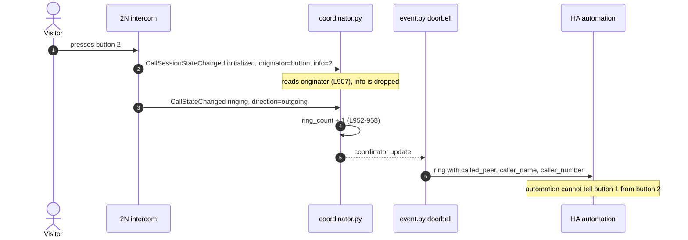

## Description

<!-- SECTION:DESCRIPTION:BEGIN -->
Why: multi-button intercoms (IP Verso with several buttons, IP Force 2/4-button, MDU installations) serve more apartments or purposes, but the integration has one doorbell for the whole device. Users cannot automate "button 2 = office" today; the only workaround is the called_id peer filter, which is one filter per config entry.

Evidence (TASK-29, E2E intercom fw 3.x): a visitor button press emits CallSessionStateChanged with originator=button and info="<button number>" (info="1" observed). CallStateChanged carries the dialled peer. A call into the intercom has originator=incoming and no info. See docs/API_REFERENCE.md, firmware quirks section.

Not decided yet (Jan: "needs thinking") - this draft is NOT ready for @copilot:
- Shape: one binary_sensor per button vs. one doorbell event entity (TASK-5) with the button number as an attribute / event type vs. both.
- How to learn the button list and names (which 2N API exposes configured buttons and their labels? keypad / display directory calls have no button number).
- Behaviour on fw that does not send originator/info (fw 2.50 unverified).
- Relation to the called_id filter (replace, keep, or migrate).
Depends on the ring-detection fix that follows TASK-29.

## Analysis (2026-10-24)

Full analysis: doc-1 "Analysis: DRAFT-1 per-button doorbell" (backlog/docs/analysis). Key finding: the button number (`info`) arrives in the first session event, before the ring, but `coordinator.py` never reads it.

<!-- SECTION:DESCRIPTION:END -->

## Acceptance Criteria
<!-- AC:BEGIN -->
- [ ] #1 Design decision on entity shape and button discovery is recorded in this task and approved by Jan
- [ ] #2 Button number of a ring is available in HA for automations, verified on the E2E intercom with a real button press
- [ ] #3 A call into the intercom never fires any per-button doorbell
<!-- AC:END -->
