# Přehled projektu ha-2n-intercom

Vstupní bod do projektu: co to je, z jakých částí se skládá a jak vypadá cesta změny od
nápadu po `main`. Podrobnosti jsou v odkazovaných dokumentech. Pravidla pro agenty jsou
v [`CLAUDE.md`](../CLAUDE.md) a [`.github/copilot-instructions.md`](../.github/copilot-instructions.md).

## 1. Co to je

- **Integrace:** Home Assistant custom component (HACS) pro 2N IP interkomy, doména `2n_intercom`.
  Python bez externích závislostí, `iot_class: local_push`, quality scale `platinum`.
  Verze v [`manifest.json`](../custom_components/2n_intercom/manifest.json), historie v [`CHANGELOG.md`](../CHANGELOG.md).
- **Repo:** `github.com/mastalir1980/ha-2N-intercom`, fork spravovaný s `@savek-cc`. Repo je **veřejné**.
- **Co umí:** kamera (MJPEG + RTSP), snímek z okamžiku zvonění, zvonek a stav hovoru, relé jako dveře / brána / spínače,
  IO vstupy, SIP registrace, access control události, služby `answer_call`, `hangup_call`,
  `grant_access`. Uživatelský popis v [`README.md`](../README.md).
- **Jak funguje:** stav přichází událostmi z log kanálu 2N (`/api/log/subscribe` + `/api/log/pull`),
  polling (60 s) je jen záchranná síť. Detail v [`ARCHITECTURE.md`](ARCHITECTURE.md),
  2N endpointy a zvláštnosti firmwaru v [`API_REFERENCE.md`](API_REFERENCE.md).

## 2. Stroje a agenti

| Kde | Co tam běží | K čemu |
|---|---|---|
| **Mac (Jan)** | repo, VS Code + Copilot (agent mode), Claude (Cowork, shell na Macu), `e2e/e2e.sh` | analýza, ruční vývoj, review, E2E na working tree |
| **VM** (mimo lokální síť) | Hermes, headless kodér `ha2n-run-task` (Copilot CLI v pískovišti) | z připraveného úkolu udělá PR, [`tools/coder/README.md`](../tools/coder/README.md) |
| **GitHub** | repo, ruleset na `main`, checky `e2e-pi`, `hassfest`, `HACS` | jediný kanál mezi VM a lokální sítí, žádná VPN |
| **Raspberry Pi** | self-hosted runner `ha2n-pi`, staging HA (`:8124`), noční běh, produkční HA (`:8123`, nikdy se nemění) | E2E proti skutečnému interkomu, [`e2e/ci/README.md`](../e2e/ci/README.md) |
| **Interkom** | skutečný 2N interkom, fw 3.x, HTTPS | ground truth pro E2E; CI používá účet jen pro čtení |

| Agent | Role | Smí | Nesmí |
|---|---|---|---|
| **Grooming agent** (Claude, plánovaný běh) | příprava zadání | jednou za čas projde roadmapu, issues a backlog a připraví jeden návrh úkolu jako draft | zakládat úkoly ready pro Copilota bez Janova „ber“, psát do issues bez souhlasu |
| **Claude** | analytik, tech lead | analýza, úkoly v Backlogu, plány, triage E2E, review, `docs/*` | psát kód bez Janova pokynu, commitovat a pushovat bez pokynu |
| **Copilot** (headless na VM) | programátor kódu integrace | úkoly přiřazené `@copilot`: implementace, unit + E2E testy, dokumentace | měnit chráněné cesty, mergovat |
| **Copilot** (VS Code na Macu) | programátor nástrojů pipeline | úkoly `@copilot-mac` se štítkem `manual-path` (`.github/`, `e2e/ci/`, `tools/coder/` …) | mergovat |
| **Hermes** (VM) | spouštěč a hlásič | `ha2n-run-task`, `ha2n-task-status`, zprávy Janovi | číst tokeny, mergovat |
| **Jan** | vlastník | zadání, merge, release, relé testy | |

## 3. Pipeline

```mermaid
flowchart LR
  SRC[roadmapa, GitHub issues,<br/>backlog, E2E bugy] --> GR[Grooming agent<br/>plánovaný běh]
  GR --> DR[návrh jako Backlog draft]
  DR --> J0([Jan: iterace nad návrhem])
  J0 -- upravit --> DR
  J0 -- ber --> C
  J1([Jan: vlastní téma]) --> C[Claude: analýza + úkol v Backlogu<br/>@copilot, Definition of Ready]
  C --> BPR[PR backlog-téma] --> M1([Jan: merge]) --> MAIN[(main)]
  MAIN --> J2([Jan: vezmi TASK-N]) --> H[Hermes na VM]
  H --> K[ha2n-run-task<br/>ready check]
  K --> S[pískoviště: Copilot CLI<br/>unit testy + validate.py]
  S --> G{patch OK?<br/>chráněné cesty, velikost}
  G -- ne --> STOP[stopped: ruční cesta<br/>VS Code na Macu + e2e.sh wip]
  G -- ano --> PR[push + PR, štítek agent]
  PR --> CH{checky<br/>e2e-pi, hassfest, HACS}
  CH -- červené --> FIX[log zpět Copilotovi<br/>max. 3 kola] --> CH
  CH -- zelené --> DONE[commit: úkol Done]
  DONE --> R([Jan: review přes Claude]) --> M2([Jan: merge]) --> MAIN
  CH -. e2e-pi .-> PI[Pi runner: zámek, deploy na staging,<br/>pytest read-only, očištěný souhrn]
```

Kroky v kulatých rámečcích dělá Jan.

### Grooming (fáze 0)

Zadání se nevymýšlí ad hoc, ale připravuje a iteruje. Grooming agent je plánovaná úloha Claude
(denně 17:51, běží proti repu na Janově Macu). Návrh připraví **jen když je fronta kodéra prázdná**
(žádný úkol *To Do* s `@copilot` a hotovými závislostmi) a žádný předchozí návrh nečeká na odpověď.
Návrh přijde do nové konverzace v projektu Claude a iteruje se v ní. Stav (rozpracovaný návrh,
odložené položky, historie) drží v gitignorovaném `e2e/state/grooming.json`. Postup:

1. **Projde zdroje:** [`ROADMAP-NAVRH.md`](ROADMAP-NAVRH.md) (sekce A až F, sekce G je mimo scope),
   otevřené GitHub issues, úkoly a drafty v Backlogu, bugy z E2E triage, [`IMPROVEMENTS.md`](IMPROVEMENTS.md).
2. **Vybere jednoho kandidáta:** priorita a doporučené pořadí v roadmapě, poptávka z issues, hotové
   závislosti, velikost na jeden PR, bugy a bezpečnost před funkcemi. Hlídá duplicity s existujícími úkoly.
3. **Připraví návrh jako Backlog draft:** proč teď a odkud (ID z roadmapy, číslo issue), současné
   a cílové chování, návrh kritérií, odhad velikosti, nejvýš tři otevřené otázky, dva náhradní kandidáti.
   Když issue řeší existující funkce, navrhne místo úkolu odpověď do issue.
4. **Iteruje s Janem.** Najednou je rozpracovaný jen jeden návrh. Na „ber“ se draft povýší na úkol,
   doplní se Definition of Ready a `@copilot`; na „odlož“ zůstane draft s poznámkou proč.
5. **Udržuje backlog:** upozorní na úkoly, které už nejsou aktuální nebo ready (např. částečně hotové).

Změny v Backlogu jdou jako backlog-only PR z `main`. Do GitHub issues agent nic nepíše bez Janova souhlasu.

### Dvě cesty změny

| Cesta | Kdy | Jak |
|---|---|---|
| **Headless** (VM) | běžný kód integrace, testy, dokumentace | Hermes → `ha2n-run-task` → PR → checky → Jan mergne |
| **Ruční** (Mac, úkoly `@copilot-mac`) | změny v chráněných cestách: `.github/`, `e2e/ci/`, `e2e/scripts/`, `e2e/run.sh`, `e2e/nightly.sh`, `e2e/e2e.sh`, `e2e/staging/`, `tools/coder/`, `CLAUDE.md`, `backlog/config.yml` | Copilot ve VS Code, `bash e2e/e2e.sh wip`, PR, review, merge. Změny `e2e/ci/` a `tools/coder/` se projeví až po ruční instalaci na Pi / VM |

## 4. Životní cyklus úkolu

| Stav / krok | Kdo | Co se děje |
|---|---|---|
| Draft (grooming) | grooming agent → Jan | návrh úkolu v `backlog/drafts`, iterace s Janem, dokud nemá otevřené otázky; pak „ber“ (draft se povýší na úkol) nebo „odlož“ |
| Analýza | Claude | čte kód, `docs/*`, E2E reporty, 2N API; odliší fakta od hypotéz |
| *To Do*, `@copilot` | Claude | úkol splňuje Definition of Ready (`CLAUDE.md`): popis s důkazy, testovatelná kritéria, plán, reference, priorita, žádné otevřené otázky |
| Na `main` | Claude → Jan | větev `backlog-<téma>` z `origin/main`, backlog-only PR, Jan ho hned mergne |
| *In Progress* | kodér | větev `task-<id>-…`, jeden úkol = jedna větev = jeden PR |
| *To Test* | kodér → Jan | mergnuto na `main`, automatické testy zelené, čeká na Janovo ověření na skutečném zařízení (zvonění tlačítkem, relé, Control4; štítek `manual-close`) |
| *Done* | kodér / Jan | po zelených checkách poslední commit v PR (stav Done, odškrtnutá kritéria, shrnutí); na `main` až Janovým mergem. Z *To Test* na *Done* až po Janově ověření. Rodičovské úkoly se zavírají ručně |

### Verze

- **Verze = milník v Backlogu** (`v1.5.0`, …). Každý úkol pro uživatele dostane při založení nejbližší otevřenou verzi, úkoly na nástrojích pipeline žádnou. Stav: `backlog milestone list`.
- **PR se mergují na `main` průběžně.** Uživatelé přes HACS instalují GitHub releasy, ne `main`, takže na `main` vzniká příští verze.
- **Uzavření verze:** všechny úkoly milníku jsou *Done* (Jan projde *To Test* a jednou pustí `e2e.sh relays`) → úkol `Release vX.Y.Z` (kodér) zvedne verzi v `manifest.json` a sepíše `CHANGELOG.md` → Jan mergne a vytvoří GitHub release → `backlog milestone archive vX.Y.Z`.

Chyby z E2E zakládá triage jako úkoly typu `bug` se štítkem `e2e` ([`e2e/agent/triage.md`](../e2e/agent/triage.md)).
Úkoly se mění **jen přes `backlog` CLI**.

## 5. Kontroly kvality

| Kontrola | Kde běží | Kdy |
|---|---|---|
| Unit testy `python3 -m unittest discover -s tests -t tests` | Mac, pískoviště VM | před každým PR (Python 3.12+) |
| `python3 validate.py` | Mac, pískoviště VM | před každým PR |
| `hassfest`, `HACS` | GitHub Actions | každý PR |
| `e2e-pi` | runner na Pi, staging HA, read-only účet | každý PR z větve repa od lidí v `E2E_PI_ACTORS` |
| `bash e2e/e2e.sh wip` | Mac → staging na Pi | ruční cesta, povinné před „hotovo“ |
| Noční běh | Pi | jen `main`, když se změnil commit, firmware nebo verze HA |
| `bash e2e/e2e.sh relays` | Mac, u dveří | **jen na Janův výslovný pokyn**, fyzicky spíná relé |

## 6. Bezpečnost v kostce

- Produkční HA (`:8123`) se nikdy nemění. Staging je jen `:8124`, všechny běhy sdílí jeden zámek.
- Tajné hodnoty (`e2e/.env`, `/etc/ha2n-ci/e2e.env`, tokeny na VM) nikdy do logů, úkolů, commitů ani PR.
  Repo je veřejné, ven jde jen očištěný souhrn.
- Interkom v CI: účet jen s *Monitoring*, kód z větve relé nesepne.
- Kodér: Copilot nemá token k repu, ven jde jen patch; orchestrátor odmítne chráněné cesty a velké patche.
- `main`: jen přes PR, žádný force push. **Merge dělá vždy Jan**, auto-merge kódu zatím ne
  (runner na Pi je ve fázi 1, kód z větve může ovlivnit výsledek `e2e-pi`).
- Změny `.github/`, `e2e/ci/`, `tools/coder/` vždy reviewuje Jan (`.github/CODEOWNERS`).

## 7. Běžné úkony

| Chci | Příkaz / postup |
|---|---|
| Nový úkol z nápadu nebo issue | řeknu Claudovi; připraví úkol a backlog PR |
| Pustit kodéra | Hermesovi „vezmi TASK-N“, nebo na VM `sudo -n -u ha2n-coder /usr/local/bin/ha2n-run-task TASK-N` |
| Stav kodéra | `sudo -n -u ha2n-coder /usr/local/bin/ha2n-task-status` (`--list` = přehled s kredity) |
| Otestovat rozpracovanou změnu | `bash e2e/e2e.sh wip` |
| Poslední výsledek E2E | `bash e2e/e2e.sh report` |
| Review PR | požádám Claude o review proti kritériím úkolu |
| Po změně `e2e/ci/` | na Pi `git pull --ff-only && sudo bash e2e/ci/install-pi.sh` |
| Po změně `tools/coder/` | na VM `git pull` v instalačním klonu a `sudo bash tools/coder/install-vm.sh hermes` |
| Release | verze v `manifest.json` + `CHANGELOG.md` (release úkol), relé test u dveří |

## 8. Mapa dokumentace

| Dokument | Obsah |
|---|---|
| [`CLAUDE.md`](../CLAUDE.md) | pravidla, role, mapa kódu, Definition of Ready / Done |
| [`ARCHITECTURE.md`](ARCHITECTURE.md) | komponenty integrace, tok dat, životní cyklus |
| [`API_REFERENCE.md`](API_REFERENCE.md) | 2N endpointy a zvláštnosti firmwaru |
| [`ROADMAP-NAVRH.md`](ROADMAP-NAVRH.md), [`IMPROVEMENTS.md`](IMPROVEMENTS.md) | proč úkoly existují |
| [`e2e/README.md`](../e2e/README.md) | E2E pipeline z Macu, staging, noční běh |
| [`e2e/ci/README.md`](../e2e/ci/README.md) | runner na Pi, bezpečnostní model, instalace |
| [`tools/coder/README.md`](../tools/coder/README.md) | headless kodér na VM, tokeny, cena běhů |
| [`README.md`](../README.md), [`INSTALLATION.md`](../INSTALLATION.md) | uživatelská dokumentace |
