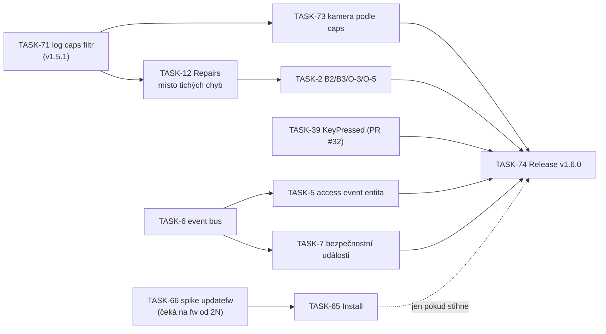

# Návrh roadmapy — ha-2N-intercom (po vydání 1.5.0)

Stav k 2026-10-24. Nahrazuje původní návrh z 2026-08-30 (jeho P1 položky jsou až na výjimky hotové).
Pravda o úkolech je vždy Backlog na `main` (`backlog task list --plain`, `backlog milestone list`).
Rozsah 1.5.1 a 1.6.0 Jan odsouhlasil 2026-10-24 (sekce 6) a je založený v Backlogu.

---

## 1. Kde jsme po 1.5.0

Hotové (1.4.0 + 1.5.0): bezpečné výchozí spojení (S1–S3 + oprava Basic nad neověřeným HTTPS),
doorbell `event` entita s HomeKit propojením, snímek posledního zazvonění (`image`), služba
`grant_access` s auditní stopou, odběr access událostí z log kanálu, všechny IO vstupy a výstupy,
SSDP discovery s ověřenou změnou IP, entita dostupnosti firmwaru, redigovaná diagnostika,
spolehlivá detekce zvonění (jen hovory z interkomu, filtr Called ID přes všechny peery).

Z původního návrhu tedy zbývá hlavně: události přístupu **v automatizacích** (A2–A4, A6),
instalace firmwaru (D1), Repairs (D5), zbytek tech-debtu (B2–B6) a velká témata kolem videa/audia.

Co se ukázalo od vydání (fakta):

- **Issue #105 (2N IP Uni, fw 2.50):** zvonění vůbec nefunguje. `BASE_LOG_EVENTS`
  (`coordinator.py:119-129`) obsahuje `InputChanged`, který IP Uni nemá; zařízení odmítne celý
  odběr kódem 12. `_build_log_event_list()` (`coordinator.py:563-578`) filtruje podle `/api/log/caps`
  jen volitelné události, základní ne. Stejný stav je i v 1.5.0. Uživatel nabízí test opravy.
- Tamtéž: kamera a `image` entita vznikají i na zařízení bez kamery (`camera/snapshot` → kód 1),
  protože `_get_platforms()` (`__init__.py:77-86`) se řídí jen volbou `enable_camera`, ne schopnostmi zařízení.
- Tamtéž: na `switch/*` a `system/caps` vrací kód 10 (chybí oprávnění). Integrace to dnes jen loguje —
  stejný „tichý" vzor jako v TASK-12 AC #2.
- Externí PR #32 (KeyPressed zvonění) je přepracovaný podle TASK-39 a čeká na v1.6.0.
- TASK-66 (spike instalace firmwaru) jde spustit až ve chvíli, kdy 2N vydá novější firmware pro E2E interkom.
  Termín tedy neřídíme my.
- Bezpečnostní revize 1.5.0 (O-1) doporučila pro 1.6 *trust on first use* — pin otisku certifikátu.

---

## 2. Návrh verze 1.6.0 — „funguje na každém 2N a přístup v automatizacích"

Cíl verze ve dvou větách: integrace se korektně chová i na menších zařízeních (IP Uni, zařízení
bez kamery, účty s omezenými právy) a uživatel na chybu dostane jasnou opravu místo mrtvých entit.
Události přístupu a bezpečnosti jdou poprvé použít v automatizacích.

### 2.0 Hned teď: patch 1.5.1 (doporučení)

| # | Položka | Proč teď |
|---|---|---|
| **TASK-71** (N1) | Základní log události odebírat jen pokud je `/api/log/caps` uvádí (fallback: bez caps chování jako dnes) | Zvonění na IP Uni nefunguje vůbec; malá změna v `_build_log_event_list`; uživatel z #105 umí ověřit |

Patch nečeká na nic dalšího z 1.6. Vydání: **TASK-72** Release v1.5.1 (milník `v1.5.1`).

### 2.1 Jádro v1.6.0

| Pořadí | Úkol | Typ | Stav dnes | Co je potřeba udělat před předáním kodérovi |
|---|---|---|---|---|
| 1 | **TASK-73** (N2) — kamera a `image` jen když zařízení kameru má (`camera/caps`; kód 1 = bez kamery), výchozí `enable_camera` podle schopností | bug | To Do, `needs-analysis` | analýza: spolehlivý signál „bez kamery“ na fw 2.x/3.x, plán |
| 2 | **TASK-12** přeformulovat: zařízení odmítá volání (kód 7/10/12) → entity `unavailable` + Repair issue s konkrétním chybějícím oprávněním; žádný „úspěšný" refresh s prázdnými daty | bug | To Do, přepsaný popis a ACs, `needs-analysis` | analýza: mapování kódů 2N na hlášky, co je nezbytné volání; plán |
| 3 | **TASK-39** — zvonění tlačítkem (KeyPressed), PR #32 | feature | **připravený**, `@copilot` | — |
| 4 | **TASK-2** rozdělit: **B2** (`switch_caps` ne v každém pollu), **B3** (sdílená session v probe), **O-5** (nepředávat údaje `MjpegCamera`), **O-3** (náhodný `cnonce` v RTSP Digest) | tech-debt | **TASK-2.2** (B2) a **TASK-2.3** (B3, O-3, O-5) připravené, `@copilot` | B4 a B6 později; B5 je skoro hotové (`hacs.json` `homeassistant: 2026.4.0`) |
| 5 | **TASK-6** — `2n_intercom_event` na event bus (ring, access) | feature | To Do, `needs-analysis` | plán, schéma payloadu, verifier tagy |
| 6 | **TASK-5** — access `event` entita (card, code, mobile_key, fingerprint, granted, denied) | feature | To Do, `needs-analysis`, závisí na TASK-6 | plán, verifier tagy; staví na event platformě z TASK-53 |
| 7 | **TASK-7** — bezpečnostní události (tamper, UnauthorizedDoorOpen, DoorOpenTooLong, SilentAlarm, LoginBlocked) | feature | To Do, `needs-analysis`, závisí na TASK-6 | plán, verifier tagy; rozhodnutí o tamperu z 2026-10-13 platí |
| 8 | **TASK-66** → **TASK-65** — instalace firmwaru tlačítkem Install přes `updatefw` | spike + feature | To Do, `on-hold` | čeká na novější firmware od 2N; release neblokuje (R3) |

### 2.2 Až po 1.6: TOFU pin certifikátu

**DRAFT-2** (N3) — při setupu uložit otisk certifikátu (SHA-256) a dál ho ověřovat (`aiohttp.Fingerprint`).
Přínos: MITM selže i bez vlastní CA a uživatelé s Basic autentizací, které 1.5.0 odstavila, by mohli
mít „ověřené" spojení bez nahrávání certifikátu. Otevřené otázky: co při výměně certifikátu
(update firmwaru, ruční regenerace) — Repair issue s potvrzením nového otisku? Jak se pin chová
s SSDP změnou IP (TASK-68)? Jan 2026-10-24: ne do 1.6, cíl další verze; nejdřív vyjasnit otázky v draftu.

### 2.3 Pořadí a závislosti

Šipky jsou doporučené pořadí, závislosti v Backlogu mají jen TASK-5/7 → TASK-6, TASK-65 → TASK-66 a release.
TASK-39 a TASK-6 nezávisí na ostatních, kodér je může brát hned po TASK-71.

### 2.4 Úklid kolem verze (Jan / GitHub)

- Zavřít issue **#11** a **#13** — slíbili jsme to „až vyjde 1.5.0" a to je dnes.
- Odpovědět na **#105** (potvrdit příčinu, nabídnout test větve).
- **PR #47** (verze firmwaru DS2 v dokumentaci) — malá změna, merge.
- `manifest.json` má `documentation` a `issue_tracker` na fork `savek-cc`, ale issues chodí sem.
  Ověřit, zda je to záměr.
- **TASK-42** archivovaný (Jan 2026-10-16: neplánuje se).

---

## 3. Pipeline (souběžně, bez milníku)

Úkoly `manual-path` / `@copilot-mac`, do verze nepatří, ale ovlivňují, jak rychle 1.6 poteče:

| Priorita | Úkol | Proč |
|---|---|---|
| 1 | Uzavřít **TASK-35**, **TASK-46**, **TASK-64** (To Test) a **TASK-40** (In Progress, 3/4) | Visí od 16.–21. 10.; chybí jen záznam ověření |
| 2 | **TASK-70** — `permissions:` a SHA piny v workflow | nález S-4 z bezpečnostní revize, levné |
| 3 | **TASK-38** — model a build interkomu z veřejného summary | veřejné repo |
| 4 | **TASK-3** přeformulovat: unit testy + `validate.py` na GitHub runneru i pro **fork PR** | fork PR (#32, #47) dnes nemají žádný automatický test; `e2e-pi` na forcích neběží |
| 5 | **TASK-59** — tester na Pi pro `[tester]` kritéria | méně ruční práce s To Test u 1.6 |
| 6 | **TASK-62**, **TASK-63** | drobné opravy kodéra |
| — | TASK-58 | zůstává `on-hold` |

---

## 4. Později (v1.7+), seřazeno podle hodnoty

| Téma | Položky | Poznámka |
|---|---|---|
| Bezpečnost spojení | DRAFT-2 TOFU pin certifikátu | viz 2.2 |
| Doorbell podle tlačítka | DRAFT-1 | potřebuje návrh tvaru entity; navazuje na TASK-39 |
| Automatizace v UI | A6 device triggers/conditions | staví na TASK-6 (`device_id` v payloadu) |
| Stav dveří | A5 `DoorStateChanged` → cover/lock bez optimistického stavu | |
| Ovládání přístupu | B2 `lock` platforma, B3 hold/release relé | |
| Repairs a setup | D5 zbytek (fw < 2.40, chybějící RTSP licence), E3 volby podle licencí | TASK-12 udělá základ |
| Údržba zařízení | D2 restart `button`, D3 záloha konfigurace | |
| Video a audio | C2 go2rtc/WebRTC, C3 obousměrné audio (nejdřív spike) | nejnáročnější |
| Distribuce a kvalita | F4 HACS default + brands, F5 `pytest-homeassistant-custom-component`, F6 blueprinty (kdo přišel, tamper, dveře dlouho otevřené) | F6 dává smysl hned po TASK-6/7 |
| Tech-debt | B4 (MJPEG vs. snapshot-stream), B6 (zúžit `except`) | |

## 5. Mimo scope (beze změny)

My2N / cloud, lift control, mass-notify, multi-tenant directory UX, licencované Automation API.
DHCP discovery vyřazeno 2026-08-30 (SSDP ho nahradilo).

---

## 6. Rozhodnutí (Jan, 2026-10-24)

| # | Otázka | Rozhodnutí |
|---|---|---|
| R1 | #105 jako patch, nebo první úkol 1.6.0? | patch **1.5.1** (TASK-71 + TASK-72) |
| R2 | Události přístupu (TASK-5/6/7) do 1.6? | všechny tři |
| R3 | Firmware Install (TASK-65/66) blokuje 1.6? | neblokuje; když spike nestihneme, přesun do další verze |
| R4 | TOFU pin certifikátu do 1.6? | ne, až po 1.6 (DRAFT-2) |
